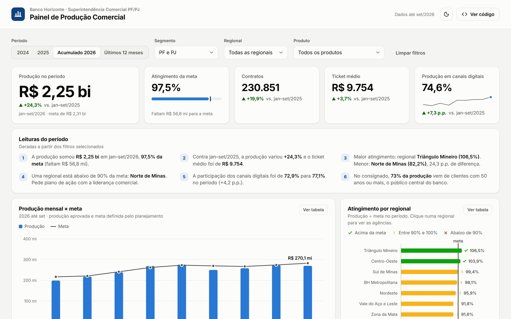
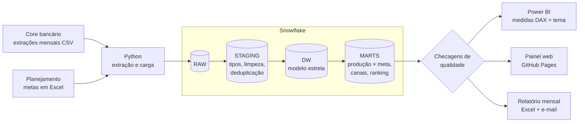
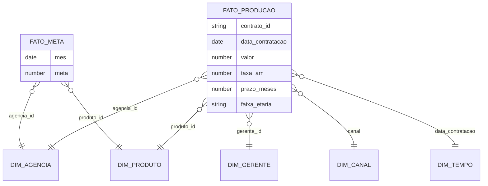
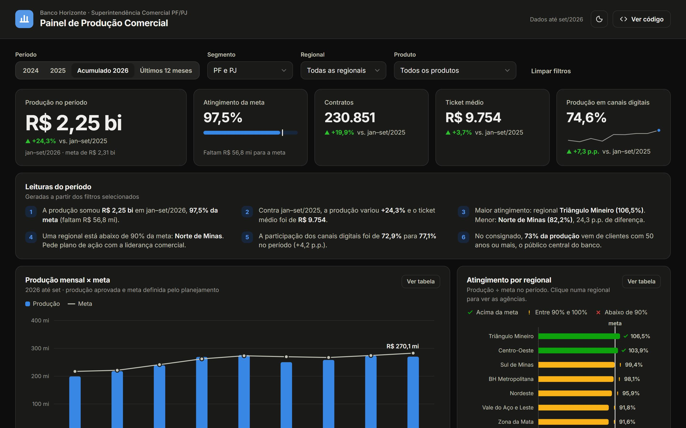
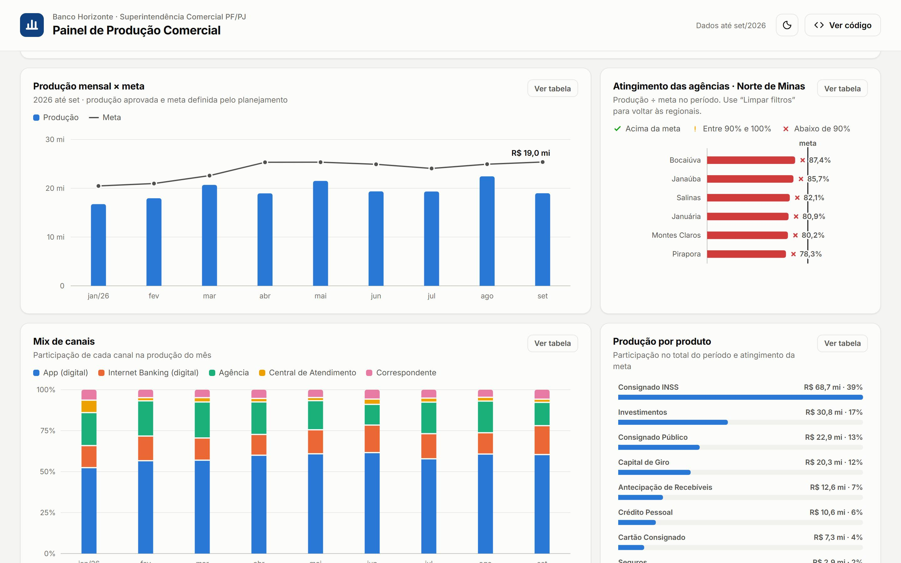
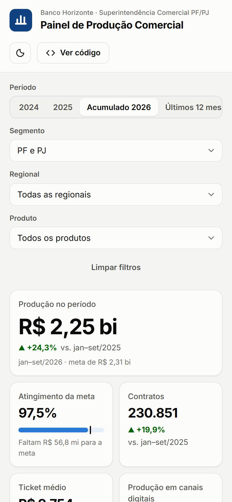

# Painel de Produção Comercial

**Pipeline de dados e painel executivo de produção comercial PF/PJ de um banco de varejo**, da extração do core até o dashboard: Python, SQL no Snowflake, modelo estrela, medidas DAX para o Power BI e uma versão web publicada.

🔗 **[Abrir o painel](https://danielpegogomes.github.io/painel-producao-comercial/)** · dados até set/2026



> Os dados são **sintéticos**: o Banco Horizonte é fictício. O gerador reproduz padrões plausíveis de um banco de varejo com foco no público 50+ (consignado INSS como carro-chefe, migração para o digital, sazonalidade, diferenças entre regionais) e também os problemas reais de uma extração de sistema legado.

---

## O problema de negócio

A Superintendência Comercial precisa acompanhar, todo mês, **quanto foi produzido contra a meta**, em que **regionais, agências e produtos** está o desvio e **por quais canais** a produção acontece. Sem isso, a liderança descobre tarde que uma regional está abaixo da meta.

O painel responde em uma tela:

- **Quanto produzimos e quanto falta para a meta?** Produção, atingimento, gap em R$ e variação contra o ano anterior.
- **Onde está o problema?** Ranking de atingimento por regional, com drill-down para as agências (clique na regional).
- **O que estamos vendendo?** Mix de produtos e participação no total.
- **Por onde?** Evolução do mix de canais e da participação do digital.
- **Leituras do período**: frases geradas a partir dos filtros (storytelling com dados para a reunião de liderança).

| Indicador (acumulado de 2026) | Valor |
|---|---|
| Produção | R$ 2,25 bi (+24,3% a/a) |
| Atingimento da meta | 97,5% |
| Produção em canais digitais | 74,6% (+7,3 p.p.) |
| Regional com menor atingimento | Norte de Minas, 82,2% |

## Arquitetura



- **SQL escrito no dialeto do Snowflake** (`TRY_TO_NUMBER`, `IFF`, `DIV0`, `QUALIFY`, `DATEADD`). Para rodar sem conta, o pipeline traduz o mesmo SQL para o **DuckDB** com [sqlglot](https://github.com/tobymao/sqlglot), então o código é um só nos dois destinos.
- **Camadas:** `RAW` guarda a origem sem alteração (auditoria) → `STAGING` padroniza → `DW` tem o modelo estrela → `MARTS` entrega tabelas prontas para consumo.
- O relatório mensal automático está em outro repositório: [automacao-relatorios-python](https://github.com/danielpegogomes/automacao-relatorios-python).

## Modelo de dados



- `FATO_PRODUCAO` no grão do **contrato** (~720 mil contratos aprovados); `FATO_META` no grão **mês × agência × produto**.
- Contrato sem gerente vai para o membro desconhecido (`-1`) em vez de sumir no `JOIN`.
- `MARTS.PRODUCAO_X_META` usa `FULL OUTER JOIN` entre realizado e meta: aparecem tanto a meta sem produção quanto a produção sem meta.

## Tratamento da origem

As extrações chegam como chegariam de um sistema legado, e o `STAGING` resolve cada problema:

| Problema na origem | Tratamento |
|---|---|
| Valores com vírgula decimal (`9465,46`) e datas em texto (`01/09/2026`) | `TRY_TO_NUMBER(REPLACE(...))`, `TO_DATE(..., 'DD/MM/YYYY')` |
| Canal escrito de 16 jeitos (`APP`, `app mobile`, `corban`, `IB`, `Televendas`…) | `CASE` de padronização para 5 canais + tipo Digital/Físico |
| ~0,3% de linhas duplicadas entre extrações | `QUALIFY ROW_NUMBER() OVER (PARTITION BY CONTRATO_ID ...) = 1` |
| Contratos sem gerente | membro desconhecido na dimensão |
| Contratos cancelados | ficam no staging (auditoria), saem da fato |

## Qualidade de dados

A cada carga, 10 regras rodam antes de publicar (`src/qualidade.py`). **As críticas interrompem a publicação**:

```
qualidade: contratos sem duplicidade após o staging          ok
qualidade: todas as datas foram convertidas                  ok
qualidade: todos os valores foram convertidos                ok
qualidade: todos os canais foram reconhecidos                ok
qualidade: toda produção tem agência cadastrada              ok
qualidade: toda produção tem produto cadastrado              ok
qualidade: produção do mart bate com a fato                  ok
qualidade: todo mês com produção tem meta                    ok
qualidade: contratos sem gerente abaixo de 0,5%              ok
qualidade: taxas dentro da faixa esperada (0,5% a 10% a.m.)  ok
pipeline concluído em 24s · 744.962 linhas extraídas · 721.892 contratos na fato
```

Os testes (`pytest`) montam uma base pequena e "suja", escrita à mão, e verificam cada regra de limpeza e o cálculo de produção × meta. Eles rodam no GitHub Actions a cada push.

## Power BI

`powerbi/` traz o modelo pronto para o Power BI Desktop:

- **`medidas.dax`**: Produção, Meta, Atingimento %, Gap, Status da meta com cor condicional, Ticket médio, % Digital, Taxa média ponderada, YTD, Ano anterior, Variação a/a, Últimos 12 meses, Ranking por `RANKX` e textos dinâmicos para títulos e resumo executivo.
- **`tema-banco-horizonte.json`**: o tema com a mesma paleta do painel web (validada para daltonismo).
- Fonte: `MARTS.PRODUCAO_X_META` direto do Snowflake ou `data/marts/producao_x_meta.parquet`.

## O painel web

HTML, CSS e JavaScript puros, com gráficos em SVG desenhados do zero e sem bibliotecas. Ele filtra no navegador uma base compacta de 900 KB exportada pelo pipeline.

- Filtros globais: período (ano, acumulado, últimos 12 meses), segmento PF/PJ, regional e produto.
- Drill-down: regional → agências.
- Tooltip em cada gráfico, visão em **tabela** para cada gráfico (acessibilidade), tema claro e escuro, versão para celular.
- Paleta categórica validada para daltonismo; status sempre com ícone e texto, nunca só pela cor.

| Tema escuro | Drill-down na regional | Celular |
|---|---|---|
|  |  |  |

## Como rodar

```bash
python -m venv .venv && source .venv/bin/activate   # Windows: .venv\Scripts\activate
pip install -r requirements.txt

python src/gerar_dados.py      # gera as extrações do core e a planilha de metas (~2 min)
python src/pipeline.py         # extrai, carrega, transforma, valida e publica (~25 s)
pytest -q                      # testes dos modelos SQL

python -m http.server 8000 -d dashboard   # painel em http://localhost:8000
```

**No Snowflake:** rode `sql/snowflake/00_setup.sql`, preencha o `.env` a partir do `.env.exemplo`, instale `snowflake-connector-python[pandas]` e execute `python src/pipeline.py --destino snowflake`. Os modelos `sql/01..04` são os mesmos.

## Estrutura

```
├── src/
│   ├── gerar_dados.py       # base sintética: core (CSV), cadastros e metas (Excel)
│   ├── pipeline.py          # extração → carga RAW → modelos SQL → qualidade → publicação
│   ├── qualidade.py         # regras de qualidade de dados
│   └── exportar_painel.py   # base compacta do painel web
├── sql/
│   ├── snowflake/00_setup.sql   # warehouse, schemas, stage e COPY INTO
│   ├── 01_staging.sql · 02_dimensoes.sql · 03_fatos.sql · 04_marts.sql
├── powerbi/                 # medidas DAX e tema
├── dashboard/               # painel web (GitHub Pages)
├── data/marts/              # marts publicados (Parquet)
└── tests/                   # pytest
```

---

Feito por **Daniel Pego** · [LinkedIn](https://www.linkedin.com/in/danielpegogomes/)
